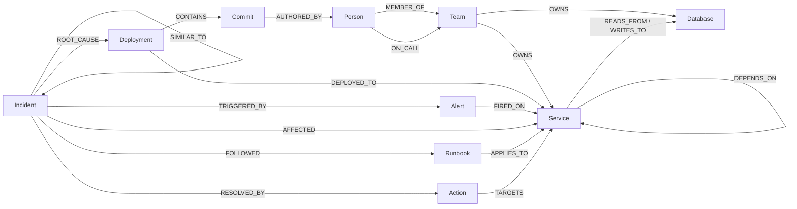

# 🛡️ SentinelGraph

> When prod breaks, SentinelGraph walks your dependency graph in **FalkorDB**, finds the change that caused it,
> pages the right human, and fixes it with your approval, then remembers how.

Built for **Graph Hacks: Context for AI Agents** (WeMakeDevs × FalkorDB) · **Track 01: Agents That Act on Connected Data**

> 🚧 Day 1 of 4: the graph, the incident scenarios and the MCP tool server work and are tested.
> The agent loop, approval-gated actions and the UI come next.

## Why a graph?

"Checkout, cart and orders are all slow" is not a text problem. It's a path problem: *what do all three depend on,
what changed there in the last hour, who wrote it, who is on call, and what breaks next if we wait?*
Each of those is one Cypher traversal or graph algorithm over connected data, and every answer comes with the
exact query and the nodes and edges it touched, so the agent's reasoning can be checked.

## What works today

| Piece | Status |
| :--- | :--- |
| Deterministic seed: 38 services, 8 teams, 18 people, 8 databases, ~100 deployments, 3 past incidents, runbooks | ✅ |
| 3 incident scenarios, including a red herring | ✅ |
| 10 graph tools, each returning `{result, cypher, node_uids, edge_uids}` | ✅ |
| MCP server (stdio) exposing those tools to any MCP client | ✅ |
| 32 pytest tests against a real FalkorDB | ✅ |
| Agent loop, approval-gated actions, write-back memory | ⏳ Day 2 |
| Web UI with the investigation path drawn on the graph | ⏳ Day 3 |

## Graph data model

One graph, `sentinel`, holds infrastructure, change history, people, alerts **and** memory. Every node has a
stable `uid` such as `svc:checkout-api`. Full reference: [docs/data-model.md](docs/data-model.md).



| Node | Key properties |
| :--- | :--- |
| `Service` | `name`, `tier`, `status` (healthy/degraded/down), `layer`, `language` |
| `Team` / `Person` | `name`, `slack_channel` / `name`, `role`, `handle` |
| `Database` | `name`, `engine`, `size_gb` |
| `Deployment` → `Commit` | `version`, `at`, `status` (live/rolled_back) → `sha`, `message` |
| `Alert` | `metric`, `value`, `threshold`, `status` (firing/resolved) |
| `Incident` | `title`, `severity`, `summary`, `steps_taken` |
| `Action` | `kind` (rollback/open_breaker/page_oncall/scale_up), `status`, `approved_by` |
| `Runbook` | `title`, `steps` |

**Direction rule:** `(checkout-api)-[:DEPENDS_ON]->(inventory-db-proxy)` means checkout calls the proxy, so
failure flows *against* the arrow. Blast radius = `(up)-[:DEPENDS_ON*1..6]->(broken)`.

## MCP tools

| Tool | Question it answers | FalkorDB feature |
| :--- | :--- | :--- |
| `get_active_alerts` | What is firing right now? | pattern match |
| `find_common_cause` | What do all the alerting services depend on, and which shared dependency is actually unhealthy at the bottom? | variable-length paths, `shortestPath` |
| `recent_changes` | What was deployed there recently, by whom? | `Deployment → Commit → Person → Team` |
| `get_service_context` | Who owns it, who is on call, what databases, last deploys? | multi-hop `OPTIONAL MATCH` |
| `trace_dependencies` | What does this service depend on? | variable-length paths (downstream) |
| `blast_radius` | What breaks if this stays down? | variable-length paths (upstream) |
| `critical_services` | Which services does everything depend on? | `algo.pageRank` |
| `chokepoints` | Which services sit on the most paths (SPOFs)? | `algo.betweenness` |
| `failure_path` | How does the failure reach the user-facing edge? | `algo.SPpaths` |
| `recall_similar` | Have we seen this before, and what fixed it? | proximity traversal over incident memory |

Unknown service names return `{"error": "not_found", "did_you_mean": [...]}`. Depth arguments are clamped to 1–6,
and every value from the model goes in as a query parameter, never string-formatted into Cypher.

### Incident scenarios

| Scenario | Alerts on | Correct answer |
| :--- | :--- | :--- |
| `db-pool-exhaustion` | checkout-api, cart-service, orders-service | `inventory-db-proxy` is down; deploy **v4.2.0** "Reduce max pool size to 10" by Priya (Platform), 6 min ago |
| `bad-config-push` | auth-service, user-profile | `feature-flags` deploy **v4.0.3** by Eva. `auth-service` is also degraded but is a symptom, since it sits on top of feature-flags |
| `cache-stampede` | search-service, recommendations | `redis-cache`, with **no** deploy. The only recent deploy is an unrelated `email-sender` change: a red herring |

## Run locally

Prerequisites: Docker (or Podman), Python 3.12.

```bash
git clone https://github.com/kalp-cg/graph-hacks.git && cd graph-hacks
cp .env.example .env                          # defaults work for local Docker
docker compose up -d falkordb                 # FalkorDB on :6380, Browser UI on http://localhost:3000

cd backend
python3.12 -m venv .venv && source .venv/bin/activate
pip install -r requirements.txt

python -m sentinel.seed --reset                           # healthy baseline
python -m sentinel.seed --scenario db-pool-exhaustion     # break something
pytest -q                                                 # 32 tests (uses a separate 'sentinel_test' graph)
```

Try a query in the FalkorDB Browser (graph `sentinel`):

```cypher
MATCH p = (s:Service)-[:DEPENDS_ON*1..3]->(:Service {name: 'inventory-db-proxy'})
WHERE s.name IN ['checkout-api', 'cart-service', 'orders-service']
RETURN p
```

### Use the tools from any MCP client

```bash
cd backend && python -m sentinel.mcp_server        # stdio
```

Claude Desktop / Cursor config (use absolute paths):

```json
{
  "mcpServers": {
    "sentinelgraph": {
      "command": "/path/to/graph-hacks/backend/.venv/bin/python",
      "args": ["-m", "sentinel.mcp_server"],
      "cwd": "/path/to/graph-hacks/backend"
    }
  }
}
```

## Project layout

```
backend/
  sentinel/
    config.py, db.py          env settings, FalkorDB connection
    seed/                     catalog, generator, history, memory, indexes, scenarios, CLI
    tools/                    read, rootcause, algorithms, memory (+ common result shape)
    mcp_server.py             MCP server over stdio
  tests/                      pytest against a real FalkorDB
docs/data-model.md            full graph schema
docker-compose.yml            FalkorDB
```

## License

MIT
