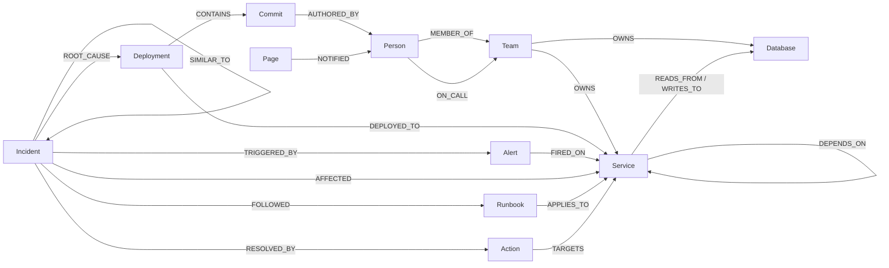

# Graph data model

SentinelGraph keeps **everything in one FalkorDB graph** (`sentinel`): the infrastructure, its change history,
the people who own it, live alerts, and the memory of past incidents. Because memory lives next to the services it
touched, "have we seen this before?" is a graph traversal, not a text search.

Every node has a stable string **`uid`** (`svc:checkout-api`, `dep:inventory-db-proxy:v4.2.0`, …).
Tools and the UI refer to nodes by `uid`, never by FalkorDB's internal `id(n)`, which is reused after deletes.

## Nodes

| Label | uid | Key properties |
| :--- | :--- | :--- |
| `Team` | `team:<slug>` | `name`, `domain`, `slack_channel` |
| `Person` | `person:<handle>` | `name`, `role`, `handle` |
| `Service` | `svc:<name>` | `name`, `tier` (critical/high/medium/low), `status` (healthy/degraded/down), `layer`, `language`, `version` |
| `Database` | `db:<name>` | `name`, `engine`, `size_gb`, `status` |
| `Deployment` | `dep:<service>:<version>` | `version`, `at` (epoch ms), `status` (live/rolled_back), `change_summary` |
| `Commit` | `commit:<sha>` | `sha`, `message`, `files_changed` |
| `Alert` | `alert:<id>` | `id`, `metric`, `value`, `threshold`, `at`, `status` (firing/resolved) |
| `Incident` | `inc:<id>` | `id`, `title`, `severity`, `status` (open/mitigated/resolved), `opened_at`, `resolved_at`, `summary`, `steps_taken` |
| `Action` | `act:<id>` | `kind` (rollback/open_breaker/page_oncall/scale_up), `status` (pending/approved/rejected/executed/failed), `reason`, `risk` |
| `Runbook` | `rb:<slug>` | `title`, `steps` |
| `Page` | `page:<id>` | `at`, `message`, `channel` |

## Relationships

| Pattern | Properties | Meaning |
| :--- | :--- | :--- |
| `(Team)-[:OWNS]->(Service\|Database)` | | Ownership |
| `(Person)-[:MEMBER_OF]->(Team)` | | |
| `(Person)-[:ON_CALL]->(Team)` | `from`, `to` (epoch ms) | On call while `from <= now < to` |
| `(Service)-[:DEPENDS_ON]->(Service)` | `uid`, `protocol`, `weight`, `latency_ms`, `breaker` (closed/open) | **A depends on B**, so failure flows *against* the arrow |
| `(Service)-[:READS_FROM\|WRITES_TO]->(Database)` | `uid` | |
| `(Deployment)-[:DEPLOYED_TO]->(Service)` | | |
| `(Deployment)-[:CONTAINS]->(Commit)` | | |
| `(Commit)-[:AUTHORED_BY]->(Person)` | | |
| `(Alert)-[:FIRED_ON]->(Service)` | | |
| `(Incident)-[:TRIGGERED_BY]->(Alert)` | | |
| `(Incident)-[:AFFECTED]->(Service)` | | |
| `(Incident)-[:ROOT_CAUSE]->(Deployment\|Service\|Database)` | | |
| `(Incident)-[:RESOLVED_BY]->(Action)` | | |
| `(Incident)-[:SIMILAR_TO]->(Incident)` | `score`, `reason` | Memory link |
| `(Incident)-[:FOLLOWED]->(Runbook)` | | |
| `(Runbook)-[:APPLIES_TO]->(Service)` | | Procedural memory |
| `(Action)-[:TARGETS]->(Service\|Deployment)` | | Audit trail |
| `(Page)-[:NOTIFIED]->(Person)` | | |

> **Direction:** `(checkout-api)-[:DEPENDS_ON]->(inventory-db-proxy)`. The blast radius of a broken `X` is everything
> that reaches `X` by following `DEPENDS_ON` forwards: `(up)-[:DEPENDS_ON*1..6]->(x)`.

## Why a graph

The questions an on-call engineer asks are path questions:

- *What do all the alerting services have in common downstream?* → variable-length traversal from several start nodes
- *What changed on that path in the last hour, and who wrote it?* → `Deployment → Commit → Person`
- *Who is on call for the owner?* → `Service ← OWNS ← Team ← ON_CALL ← Person`
- *How much breaks if it stays down?* → reverse traversal + PageRank / betweenness
- *Have we seen this before?* → incidents within two hops of the affected services
